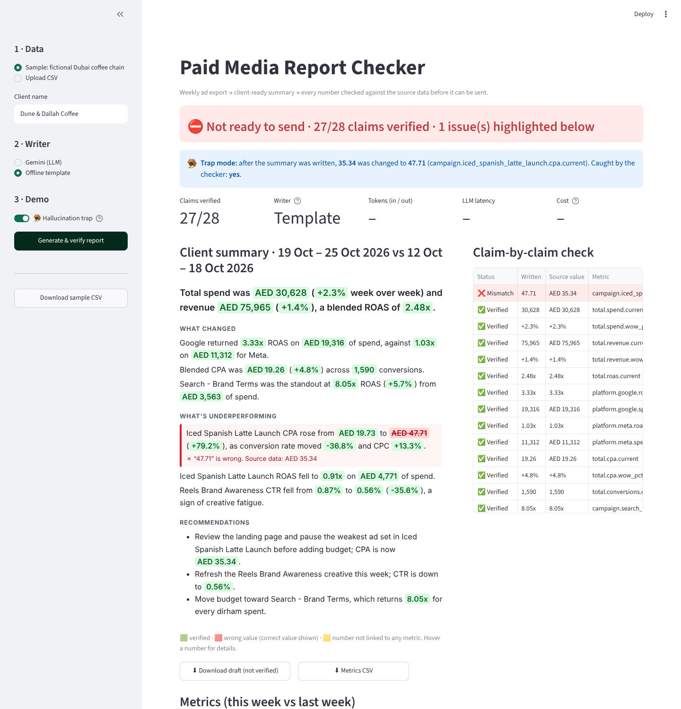
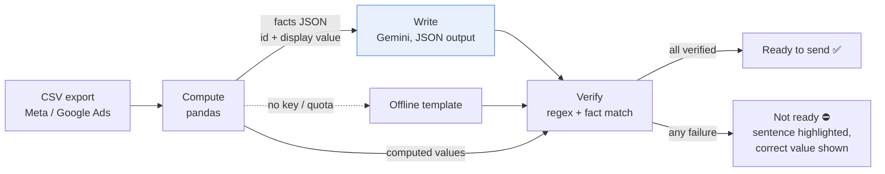
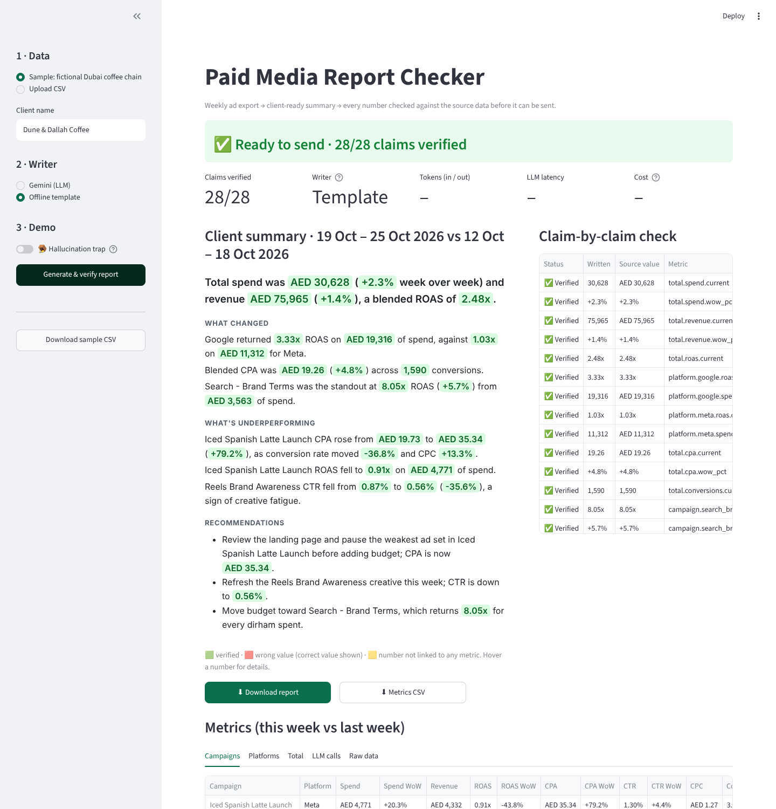

# Paid Media Report Checker

Upload a weekly ad-campaign export and get a client-ready summary. Before it can be sent, every number in that summary is checked against the source data.



## The problem

Agencies spend hours every week turning Meta and Google Ads exports into client summaries. LLMs can write those summaries in seconds, but they sometimes get a number wrong: a CPA of AED 47.71 when the real figure is AED 35.34. One wrong number in a client email costs more trust than the hours saved. You need the speed of an LLM and the certainty of a spreadsheet.

## How it works



1. **Compute** (`checker/metrics.py`). pandas computes spend, impressions, clicks, conversions and revenue. From those totals it derives CTR, CPC, CPA, ROAS and conversion rate, plus the week-over-week change for every campaign, each platform and the total. Ratios come from summed totals, not averages of daily ratios. Division by zero gives "undefined", never 0.
2. **Facts** (`checker/facts.py`). Each metric becomes a fact with a stable id and a display value, e.g. `campaign.iced_spanish_latte_launch.cpa.current = "AED 35.34"`. Deterministic rules flag what matters: CPA spikes, CTR drops, the top ROAS campaign, ROAS below 1x.
3. **Write** (`checker/writer.py`). Gemini receives the facts and signals only, never the raw rows. It returns structured JSON: sentences, each with a list of claims (`number_text` and `fact_id`). The prompt forbids any arithmetic. If a model is rate-limited, the next model is tried. If they all fail, an offline template writes the summary so the demo never stops.
4. **Verify** (`checker/verifier.py`). The checker never trusts the LLM's own claim list:
   - It extracts every number from the sentence text with a regex (AED, %, x, k/M, commas, signs).
   - It pairs each number with a claim. A number with no claim, or a claim citing an id that doesn't exist, is **Unsupported**.
   - It compares the number with the value pandas computed, at the precision it was written. "38.2%" passes for 38.15–38.25, and "AED 41" passes for 40.5–41.5. A wrong value is a **Mismatch**, and the UI shows the correct value.
   - Direction words must match the sign: "CTR rose 35.6%" fails when CTR fell.
   - Anything other than **Verified** marks the report **Not ready to send**, and the download is labelled a draft.
5. **Trap mode** (`checker/trap.py`). After the summary is written, trap mode changes one number in both the text and the claim, keeping the correct fact id. That is exactly what a real hallucination looks like. The checker has to catch it, and the tests prove that it does.

Every LLM call logs its model, status, latency, input and output tokens (thinking tokens included) and cost. Cost is the paid-tier list price for Gemini 3 Flash ($0.50 / $3.00 per 1M tokens). On the free tier the real cost is $0.

## Run it

```bash
pip install -r requirements.txt        # Python 3.11+
cp .env.example .env                   # optional: add GEMINI_API_KEY
export $(grep -v '^#' .env | xargs)    # or set GEMINI_API_KEY however you prefer
streamlit run app.py                   # http://localhost:8501
```

Without a key, the app uses the offline template writer, and everything else works the same.

| Command | What it does |
| --- | --- |
| `make run` | Start the Streamlit app |
| `make test` | 48 pytest tests: metrics against hand-worked numbers, verifier rules, the trap, writer retries and fallbacks with a fake Gemini client, and the sample dataset |
| `make report` | Write `out/report.html` from the CLI and print the JSON verification result (exit code 0 = ready, 1 = not ready) |
| `make trap` | The same, with the hallucination trap |
| `make sample` | Regenerate `data/sample_campaigns.csv` |

The CLI (`python -m checker.cli <csv>`) is the hook for scheduled runs: cron, an n8n Execute Command node, or CI.

### CSV format

`date, platform, campaign, ad_set, spend, impressions, clicks, conversions, revenue`, with one row per day per ad set. The last 7 days in the file are "this week" and the 7 days before them are "last week". Column names are case-insensitive. Missing columns, negative values or a missing previous week give a clear error.

### Sample data

`data/sample_campaigns.csv` is synthetic, seeded data for **Dune & Dallah Coffee**, a fictional Dubai coffee chain. It covers 2 weeks, Meta and Google, 6 campaigns, 12 ad sets and 168 rows. Three patterns are built in:

| Campaign | Pattern |
| --- | --- |
| Iced Spanish Latte Launch (Meta) | CPA spike: AED 19.73 → 35.34 (+79.2%) |
| Search - Brand Terms (Google) | ROAS winner: 8.05x |
| Reels Brand Awareness (Meta) | Falling CTR: 0.87% → 0.56% (−35.6%) |



## Project layout

```
app.py                  Streamlit UI
checker/
  metrics.py            pandas metric calculations (the only place numbers are computed)
  facts.py              fact ids, display formats, signal rules
  models.py             Pydantic schema for the structured summary
  writer.py             Gemini writer: model chain, one retry on invalid JSON, call logging
  offline_writer.py     template writer (no LLM)
  verifier.py           number extraction and claim checking
  trap.py               hallucination trap
  report.py             highlighted HTML (UI and download)
  pipeline.py           CSV → metrics → summary → verification
  llm_log.py            tokens, latency, cost
  cli.py                headless run for schedulers
  sample_data.py        synthetic dataset generator
data/sample_campaigns.csv
tests/
```

## Limitations

- **The checker verifies numbers, not judgement.** "Shift budget to Brand Search" is checked for the numbers it quotes, not for whether it's the right call. Wording without digits ("the best campaign") isn't checked either. Next step: a second rule-based pass on superlatives, checked against rankings.
- **Only quoted metrics.** The LLM can't cite derived figures it wasn't given, such as share of spend or the difference between two campaigns. That is by design. If clients want them, add them to `facts.py` so pandas computes them.
- **Week-over-week only**, on a fixed 7-day window. No month-to-date, pacing against budget, or attribution windows.
- **CSV in.** No live ad-platform connection.

## Next steps

- Pull data from the Meta Marketing API and Google Ads API instead of a CSV, using the same pipeline.
- Arabic summaries for GCC clients. The verifier already handles the number formats, but it would need Arabic-Indic digits and Arabic direction words.
- Per-client brand-voice templates and a style guide passed to the writer.
- A scheduled run (n8n or cron calling `checker.cli`) that posts the report to Slack or email only when it's ready to send, and alerts the account manager otherwise.
- Store each run's facts, summary and verification for an audit trail.
